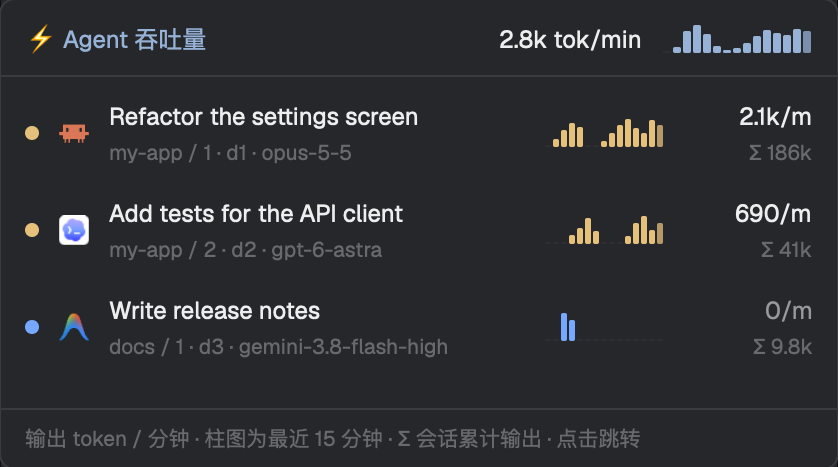

# herdr-mods

给 [Herdr](https://herdr.dev) 桌面 app 用的两个 mod：在窗口里直接看 AI 套餐用量和 agent 的输出速度。

| Mod | 作用 |
|---|---|
| [`usage-bar`](usage-bar/) | 窗口底部的一条栏：Claude 套餐用量（5 小时 / 7 天）、所有 agent 的吞吐量、CPU、内存、电量、时钟 |
| [`agent-throughput`](agent-throughput/) | 点 ⚡ 打开的弹窗：每个 agent 每分钟输出的 token、最近 15 分钟柱状图和会话累计输出，点一行跳到那个 agent |




（弹窗预览图用的是示例数据。）

## 安装

**两个要一起装**：用量栏的吞吐量来自 `agent-throughput` 的脚本，点 ⚡ 打开的也是它。

最简单：把文件夹地址交给 agent（Claude Code、Codex……），让它按 Herdr 的 `~/.config/herdr-app/AGENTS.md` 里的步骤安装。

手动安装：

1. 把 `usage-bar/` 和 `agent-throughput/` 复制到 `~/.config/herdr-app/mods/`。
2. 在你的布局里给用量栏加一个块（如果是 Herdr 自带的布局，先复制一份再改），比如放在某一列的最下面：
   ```json
   { "id": "usage", "type": "block", "content": { "mod": "usage-bar" }, "size": { "px": 26 } }
   ```
3. 运行 `herdr-app check ~/.config/herdr-app/mods/usage-bar`（`agent-throughput` 同样检查一遍）。

## 需要什么

- macOS（CPU、内存、电量用的是 macOS 的命令）
- Node.js（Homebrew、nvm、volta 装的都行，会自己找）
- 看 Claude 用量：已登录的 [Claude Code](https://claude.com/claude-code) 命令行
- 看吞吐量：在 Herdr 里运行的 agent（Claude Code、Codex、Antigravity CLI）

## 会访问什么

两个 mod **不包含、也不上传任何登录凭据**，所有信息都是运行时在本机读取的：

- **运行的程序**：`node`、`claude`、`hc`、`/usr/bin/sqlite3`、`/usr/sbin/lsof`、`/bin/sh`
- **读取的文件**：`~/.claude`（会话）、`~/.codex`（会话和状态数据库）、`~/.gemini/antigravity-cli`（对话；`agy-usage.mjs` 还会读 agy 的登录凭据）
- **网络**：Claude 用量通过本机的 `claude` 命令行查询；`agy-usage.mjs` 用 agy 的登录凭据请求 Google 的 `cloudcode-pa.googleapis.com`。`agent-throughput` 不联网
- **写入缓存**：`~/.cache/herdr-statusbar/`

## 附带的脚本

`usage-bar/` 里还有两个命令行脚本，各自输出 JSON。用量栏不显示它们，是给别的工具用的：

- `codex-usage.mjs`：Codex 的 5 小时、7 天额度和套餐
- `agy-usage.mjs`：Antigravity 每个模型的额度，以及订阅档位（例如 Google AI Pro）

想从头自己做一份，可以看各个 mod 里的 `RECIPE.md`。

## 许可证

[MIT](LICENSE)
