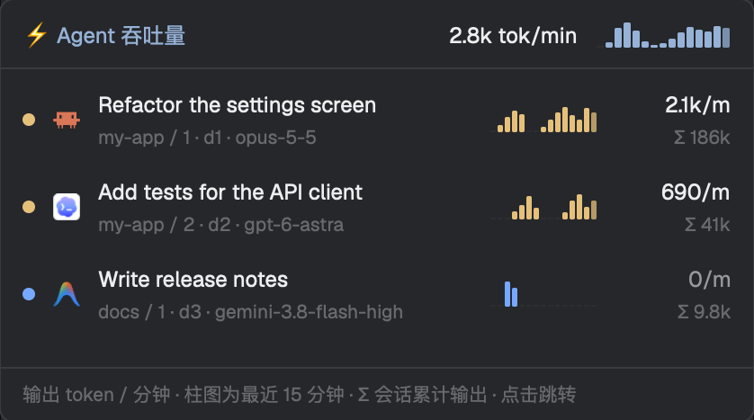

# Agent Throughput

A popup listing every live agent and how fast it is writing: output tokens per minute, a 15‑minute bar chart and the session's total output. Claude Code, Codex and Antigravity (agy) are read from their own session files. Click a row to jump to that agent. It opens from the `usage-bar`'s ⚡, or sits in a layout block.

## What you see

A 400×360 popup (as `usage-bar` opens it), background `popover`, text 12px `muted`. Top to bottom:

1. **Header**, 12px sides, 10px top, 8px bottom, `border` line below: `⚡ Agent 吞吐量` in `accent` semibold; flexible space; the total `2.8k tok/min` in `foreground` semibold; a 75×14 sparkline of the total.
2. **One row per agent** (in `agents()` order), 12px sides, 6px tall padding, 10px gaps, `hover` background on hover:
   - a 7px dot in the agent's status color (`working`, `blocked`, `done`, `idle`… from the theme, else `dim`);
   - the program's 15px icon (tinted `muted` when the program's icon is a tint icon);
   - two lines: the title (or program name, or address) in `foreground`, truncated; below in 10.5px `dim`: `<space> / <tab> · <address> · <model>` (the model without its `claude-` prefix);
   - on the right: a 60×14 sparkline in the status color, then a 64px column right‑aligned: `2.8k/m` (`foreground` semibold when it is writing, else `muted`) over `Σ 190k` in 10.5px `dim` (`Σ ≥…` when only the end of a large file was read).
   - Agents it can't read show `不支持` (unsupported); before the first result, `…`; an agent missing from the result, `—`.
3. **Empty**: `没有正在运行的 agent` (no agents running), 14px padding, `dim`.
4. **Footer**, `border` line above, 10.5px `dim`: `输出 token / 分钟 · 柱图为最近 15 分钟 · Σ 会话累计输出 · 点击跳转` (output tokens per minute · bars are the last 15 minutes · Σ session total · click to jump).

Sparklines: bars evenly split over the width with a 1px gap, height scaled to the busiest minute (at least 1.5px), empty minutes 1px in `raised`; the current minute at 75% opacity. Numbers: `1.3k`, `12k`, `2.1M`.

## How it behaves

- Click a row: close the popup (when it is one) and `run("agent.focus", {terminal})`.
- It reads the shared `agent.throughput` (written by `usage-bar` every 5 s). Only when that is missing or older than 12 s does it run the script itself, then shares the result.
- Status colors follow the agent live; a writing agent's number turns `foreground`.

## Built from

- `main.js`: `View` with `h_flex`, `v_flex`, `div`, `svg`, `image`; `agents`, `theme`, `shared`, `setShared`, `exec`, `home`, `run`, `props`, `closeOverlay` from `herdr`. Exports `poll`, `sparkline`, `totals`, `fmt`, `KEY` for other mods.
- `throughput.mjs` prints `{at, agents: {<address>: {app, supported, kind, model, now, series[15], out, in, partial}}}`:
  - lists live local terminals with `hc ls --json`, then `hc get <t> --json` for the foreground process, cwd and title;
  - **Claude Code**: `~/.claude/sessions/<pid>.json` → `sessionId` → `~/.claude/projects/*/<id>.jsonl`; counts each assistant message's `usage.output_tokens` (deduplicated by message id), input = `input_tokens + cache_creation_input_tokens`;
  - **Codex**: the thread named in the terminal title (`<thread name> | <folder>`) looked up in `~/.codex/state_*.sqlite` (`threads.name`, `cwd`, `rollout_path`) with `/usr/bin/sqlite3 -readonly`; before a thread is named, the folder's rollout that began first after the terminal started (start time from the file name `rollout-YYYY-MM-DDTHH-MM-SS-…`). Output from the `token_count` events' `total_token_usage` deltas;
  - **Antigravity**: the conversation SQLite agy keeps open (`lsof`), else the newest for its folder; step timestamps and token counts from its protobuf metadata;
  - files are read incrementally; offsets and the last 15 minutes are cached in `~/.cache/herdr-statusbar/throughput-cache.json`.
- `node` is found through `/bin/sh` (`RUN_NODE`): Homebrew `/opt/homebrew/bin/node` → `/usr/local/bin/node` → `PATH` → the login shell's `command -v node`.
- `mod.json` is `{"place":"none"}`; open it as a popup with `openOverlay({ mod: "agent-throughput", kind: "popup", width: 400, height: 360 })`, or put it in a layout block.

## Watch out

- **Reaches outside its folder**: runs `node`, `hc`, `/usr/bin/sqlite3`, `/usr/sbin/lsof`; reads `~/.claude`, `~/.codex`, `~/.gemini/antigravity-cli`; writes its cache to `~/.cache/herdr-statusbar/`. No network.
- A Codex rollout's first line (`session_meta`, the whole system prompt) is over 20KB: read the whole line, never a fixed 16KB.
- Codex now runs one shared `app-server` that keeps every Codex's rollout open, so "the rollout this process has open" is wrong; use the title, then the start time. Two Codex started in one folder within the same second can't be told apart until their threads are named after the first turn.
- macOS `awk` compares strings by locale collation (different Chinese names compare equal): match names in SQLite, byte for byte.
- A GUI app's `PATH` is the system's: without `RUN_NODE`, `exec("node")` misses Homebrew and nvm.
- Only local terminals (addresses with `/` are other machines and are skipped).

## Done when

- `herdr-app check mods/agent-throughput` passes.
- With a Claude Code, a Codex and an agy agent running, each has a row with its model, and a reply makes its number and bars move within ~10 s.
- Two Codex in one folder, each after its first turn, show different totals that match their own sessions.
- Clicking a row focuses that agent and closes the popup.
- Its total matches the `usage-bar`'s ⚡ number.
